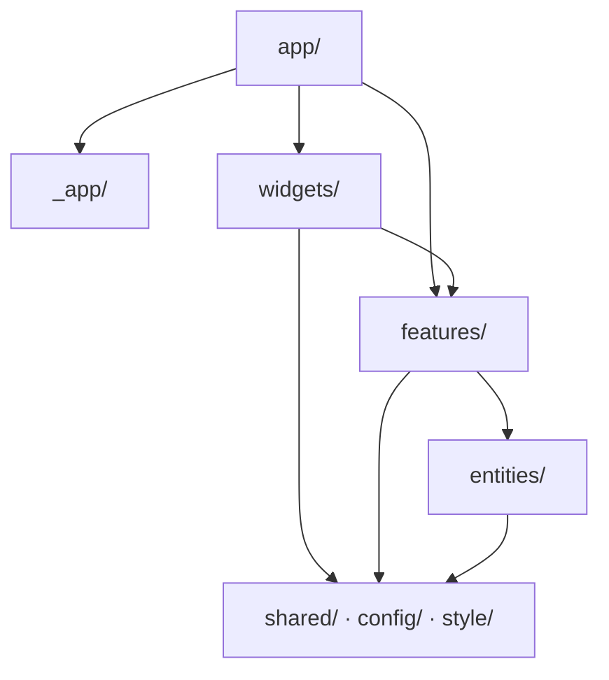

# 구조와 의존 방향

단일 Next.js 앱이다. 앱 안은 CleanFSD 로 나눈다.
슬라이스 분할은 FSD(Feature-Sliced Design)를 따르고, entity 안의 데이터 접근은 계층으로 나눈다.
Kozipsa(`admin-next/docs/architecture.md`)의 구조를 가져오고, 백엔드가 없어 필요 없는 부분은 뺐다.(2026-11-11 사용자 결정)

**파일을 새로 만들거나 옮기기 전에 이 문서를 읽는다.**
이름을 짓는 규칙은 [conventions.md](./conventions.md) 에 있다.

## 원칙

1. **의존은 위에서 아래로만 흐른다.** 역방향 import 를 하지 않는다.
    - `entities` 가 `features` 를 참조하면 도메인 로직이 특정 화면에 묶여 재사용할 수 없다.(Kozipsa 원칙 2)
2. **애매하면 좁은 범위에 둔다.** 2번째 사용처가 생겼을 때 위로 올린다.(Kozipsa 원칙 3)
3. **최상위 디렉터리를 새로 만들지 않는다.** `src` 아래 10개가 전부다.(Kozipsa 원칙 4)

## 1. Kozipsa 와 다른 점

| 항목          | Kozipsa                                   | 이 저장소                                                   | 이유                                                                   |
| ------------- | ----------------------------------------- | ----------------------------------------------------------- | ---------------------------------------------------------------------- |
| 저장소        | pnpm + Turborepo 모노레포                 | 단일 앱                                                     | 앱이 하나라 공용 패키지로 나눌 대상이 없다                             |
| 데이터        | 백엔드 API                                | Firestore, 이미지는 Vercel Blob, 로그인은 Firebase Auth     | 소개 문구 · 경력(2026-11-18)과 작업(2026-11-19)을 Firestore 로 옮겼다  |
| entity        | model · actions · services · repositories | model · services · repositories, 변경 요청이 있으면 actions | 서버 액션이 필요한 entity 만 `actions` 를 둔다(2026-11-12 사용자 결정) |
| 디자인 시스템 | `packages/ui` + Storybook                 | `src/shared/ui` + `src/style/tokens`                        | UI 를 함께 쓸 다른 앱이 없다                                           |
| 상태          | Zustand · TanStack Query                  | 쓰지 않는다                                                 | 전역 상태와 서버 상태가 없다                                           |

따로 적지 않은 것은 2026-11-11 플랜 승인 때 정했다.

## 2. 디렉터리

```
portfolio/
├── content/          저장소로 옮기기 전의 작업 원문 (projects.ts). 옮긴 뒤 지운다
├── docs/             규칙 문서
├── e2e/              Playwright
└── src/
    ├── _app/         Provider·전역 리스너
    ├── app/          App Router 라우트
    ├── widgets/      여러 기능을 조합하거나 모든 페이지에 붙는 UI (header, footer, backdrop, contact, pageTransition, adminHeader)
    ├── features/     기능 단위 (hero, featuredProjects, …)
    ├── entities/     도메인 데이터 (project, experience, session, about)
    ├── shared/       앱 공용 (ui/, util/)
    ├── config/       사이트 정보, 내비게이션
    ├── style/        global.css, tokens/
    ├── asset/        코드가 import 하는 정적 자원 (SVG 등)
    ├── types/        .d.ts 앰비언트 선언
    └── proxy.ts      요청을 페이지보다 먼저 받는 Next 의 파일. 관리 화면의 1차 검사 (4.2절)
```

### 2.1 그림 파일을 두는 곳

**코드에 포함하는 자원은 `src/asset/`, 주소로 불러 쓰는 이미지는 `public/images/` 에 둔다.**(2026-11-16 사용자 결정)

| 쓰는 방식                                    | 위치             | 지금 있는 것                                  |
| -------------------------------------------- | ---------------- | --------------------------------------------- |
| `import` 로 가져와 번들에 포함한다           | `src/asset/`     | 아직 없다                                     |
| `/images/...` 주소로 불러 쓴다(`next/image`) | `public/images/` | `characters` · `logo` · `projects` · `skills` |

## 3. 계층

```
app/          라우트. page/layout/error, opengraph-image, sitemap 만. 로직 금지
_app/         Provider. app/ 만 import 한다
widgets/      여러 feature 를 조합하거나 모든 페이지에 붙는 UI. 컴포넌트 + index.ts, 필요하면 model/
features/     기능 단위. ui/ + model/ + index.ts
entities/     도메인 데이터. model/ · services/ · repositories/, 필요하면 actions/
shared/       도메인 무관 공용. ui/ · util/
config · style · asset · types   어느 계층에서나 import 할 수 있다
```

의존은 `app → widgets → features → entities → shared` 한 방향이다.



**`entities` 끼리도 서로 import 하지 않는다.** 조합이 필요하면 상위인 `features` 에서 합친다.(Kozipsa 3절)
**예외는 `session` 하나다.** 변경 요청을 받는 서버 액션은 세션을 다시 검사해야 하므로, entity 는 `session` 을 import 할 수 있다.(`eslint.config.mjs` 의 `boundaries/dependencies`, `src/entities/about/actions/about.actions.ts` · `src/entities/experience/actions/experience.actions.ts`)

**`features` 끼리, `widgets` 끼리도 서로 import 하지 않는다.** 슬라이스 사이의 조합은 한 단계 위에서 한다.

**슬라이스는 `index.ts` 로만 공개한다.** 바깥에서 `@/features/hero/ui/Hero` 처럼 안쪽 파일을 부르지 않는다.(Kozipsa conventions 4.1)

이 절의 규칙은 ESLint 가 검사한다.(`eslint.config.mjs` 의 `boundaries/dependencies` 와 `no-restricted-imports`)

**라우트 핸들러(`route.ts`)는 서버 액션으로 받을 수 없는 요청에만 둔다.** 지금은 썸네일을 올릴 권한을 내주는 1곳이다. `@vercel/blob` 의 `upload` 가 주소로 토큰을 요청한다.(`src/app/admin/api/project-images/route.ts`)
세션을 검사하고 entity 의 `services` 를 부르는 일만 한다.

### 3.1 계층 판단 기준

| 계층        | 판단 기준                                          |
| ----------- | -------------------------------------------------- |
| `app/`      | "URL 에 대응하는가?"                               |
| `widgets/`  | "여러 feature 를 조합하거나 모든 페이지에 붙는가?" |
| `features/` | "하나의 섹션·기능 단위인가?"                       |
| `entities/` | "프로젝트·경력 같은 데이터인가?"                   |
| `shared/`   | "도메인 무관인가?"                                 |

**위젯도 `model/` 을 가질 수 있다.**(2026-11-16 사용자 결정)
모션 정의와 상수처럼 마크업과 변경 이유가 다른 것을 `model/` 에 둔다. 파일 이름은 `features` 의 `model/` 과 같은 규칙을 따른다.([conventions.md](./conventions.md) 2절)
지금은 `widgets/header/model/header.motions.ts` 와 `widgets/backdrop/model/backdrop.constants.ts`, `widgets/pageTransition/model/` 의 `pageTransition.constants.ts` · `pageTransition.utils.ts` 가 있다.
컴포넌트는 `ui/` 로 나누지 않고 위젯 폴더 바로 아래에 둔다.(`src/widgets/header/`)

**헤더는 레이아웃이 그린다.**(2026-11-18 사용자 결정)
헤더가 있는 공개 페이지(홈 · 작업 · 소개)를 `(site)` 로 묶고, 그 레이아웃이 헤더와 페이지 맨 위(`#top`)의 틀을 갖는다.(`src/app/(site)/layout.tsx`)
페이지는 배경과 본문 · 푸터를 채운다. 페이지를 옮겨도 헤더는 다시 그려지지 않아, 지금 메뉴는 헤더가 주소에서 읽는다.(`src/widgets/header/HeaderBar.tsx`)
관리 화면도 같은 방식이다.(4.2절)

**배경은 공통과 페이지 전용으로 나눈다.**(2026-11-16 사용자 결정)
점 무늬와 가장자리 붓 자국은 모든 페이지가 같아 `widgets/backdrop` 에 둔다.
낙서는 페이지의 섹션 배치에 맞춰 자리를 잡으므로 페이지마다 따로 둔다. 홈은 `features/homeDoodles`, 소개는 `features/aboutDoodles`, 작업은 `features/workDoodles` 다.
`app` 의 페이지가 `<Backdrop>` 안에 그 페이지의 낙서를 넣어 조합한다. 배경은 `(site)` 레이아웃의 틀에 기대어 헤더 뒤까지 깔린다. 낙서 하나를 그리는 것은 `shared/ui/doodle` 이다.

### 3.2 공통 컴포넌트를 두는 곳

위에서부터 검토해 **가장 먼저 해당하는 곳**에 둔다.(Kozipsa 3.2 에서 후보만 줄였다)

```
shared/ui       ← 도메인 무관 기본 컴포넌트 (Button, Icon, Panel)
widgets/        ← 여러 기능을 조합하거나 모든 페이지에 붙는 UI
features/*/ui   ← 특정 기능에서만 쓰는 UI
```

`shared/ui` 의 Button · Input · Textarea · Separator · Label · Field · AlertDialog 는 shadcn 을 바탕으로 한다.(`components.json`, 2026-11-17 사용자 결정) 파일 이름과 export 는 [conventions.md](./conventions.md) 2.5절을 따른다.

`shared/ui` 의 Table · Pagination · DataTable · Select · Switch 와 확인 창(ConfirmDialog) · Toast 는 Kozipsa `packages/ui` 에서 가져왔다.(2026-11-18 사용자 결정) 원본과 다른 점은 컴포넌트마다의 문서에 있다.(`src/shared/ui/dataTable/dataTable.md`)

`shared/ui/tiptapEditor` 는 Tiptap 을 감싼 본문 에디터다. 읽는 화면인 `tiptapViewer` 와 같은 서식 CSS 를 쓴다.(2026-11-19 사용자 결정, `src/shared/ui/tiptapEditor/TiptapEditor.md`)

`shared/ui/size` 는 컴포넌트가 아니다. Button · Input · Textarea 가 함께 읽는 크기 눈금을 둔다.(`src/shared/ui/size/size.constants.ts`, 2026-11-17 사용자 결정)

## 4. Entity 계층

목적은 **원문을 읽는 위치를 `repositories` 한 곳으로 고정**하는 것이다. 원문은 외부 저장소에 있다.
원문 형식이 바뀌어도 `repositories` 만 고치면 된다.

```
page(서버 컴포넌트) → <e>.services.ts → <e>.repositories.ts → 저장소
```

| 계층           | 책임                                             | 금지             |
| -------------- | ------------------------------------------------ | ---------------- |
| `services`     | 가공(정렬, 날짜 포맷, 화면용 `~Data` 로 변환)    | 직접 파일 읽기   |
| `repositories` | `interface` 선언과 구현. 원문 읽기와 스키마 검증 | 가공             |
| `model`        | zod 스키마, 타입                                 | 파일 읽기, 가공  |
| `actions`      | 서버 액션. 입력 검증, 쿠키 쓰기, 화면 이동       | 저장소 직접 호출 |

**entity 는 서버에서만 실행한다.** `services` 와 `repositories` 첫 줄에 `import 'server-only';` 를 둔다.
클라이언트 컴포넌트에는 `page` 가 가공된 `~Data` 를 prop 으로 넘긴다.

**변경 요청은 `actions` 의 서버 액션으로 받는다.**(2026-11-12 사용자 결정, `docs/plan/admin/README.md` 요구사항 7)
파일 첫 줄에 `'use server';` 를 둔다. 클라이언트 컴포넌트가 entity 에서 직접 가져올 수 있는 것은 서버 액션과 `model` 뿐이다.
지금은 `session` · `about` · `experience` · `project` 에 있다.(`src/entities/session/actions/` · `src/entities/about/actions/` · `src/entities/experience/actions/` · `src/entities/project/actions/`)

```
폼(클라이언트) → <e>.actions.ts → <e>.services.ts → <e>.repositories.ts → 저장소
```

### 4.1 저장소

Firestore 를 부르는 곳은 `repositories` 다. 서버만 읽고 쓴다.(`src/shared/util/firebaseAdmin.ts`)

- 읽은 결과는 `services` 가 `'use cache'` 로 캐시하고 태그를 붙인다. 공개 화면이 요청마다 저장소를 부르지 않는다.(`src/entities/about/services/about.services.ts`)
- 저장한 서버 액션이 그 태그의 캐시를 지운다. 공개 화면은 저장한 직후의 내용을 그린다.(`src/entities/about/actions/about.actions.ts`)
- 저장한 시각은 서버가 기록한다. 캐시에 담을 수 있게 문자열로 바꿔 읽는다.(`src/entities/about/repositories/about.repositories.ts`)
- 여러 건을 두는 컬렉션은 문서 1개가 1건이고, 문서의 id 는 저장소가 발급한다. 순서는 `services` 가 정한다.(`src/entities/experience/repositories/experience.repositories.ts` · `src/entities/experience/services/experience.services.ts`)
- 빌드할 때도 저장소를 읽는다. 빌드하는 곳에 환경 변수 5개가 있어야 한다.(`src/shared/util/serverEnv.ts`)
- 순서를 정해 두는 컬렉션은 문서에 `order` 를 두고, `services` 가 그 값으로 놓는다.(`src/entities/project/services/project.services.ts` 의 `sortProjectList`)
- 폼이 다루지 않는 항목(순서 · 등록 시각)이 있는 문서는 통째로 바꾸지 않고 폼의 항목만 바꾼다. 비운 선택 항목은 항목째로 지운다.(`src/entities/project/repositories/project.repositories.ts` 의 `updateProject`)
- 에디터로 받은 HTML 은 `services` 가 저장하기 전에 정제한다. 읽는 화면은 정제하지 않는다.(`src/entities/project/services/project.services.ts` 의 `sanitizeProjectBody`, `src/shared/ui/tiptapViewer/TiptapViewer.md`)

이미지는 Vercel Blob 에 둔다. 부르는 곳은 같은 `repositories` 다.(`src/entities/project/repositories/project.repositories.ts`)

- 파일은 브라우저가 긴 변 1000px 이하로 줄여 저장소에 바로 올린다. 서버는 형식과 크기의 제한을 넣은 토큰만 내준다. 서버를 거치면 요청 크기 제한(4.5MB)에 걸려 5MB 를 받지 못한다.(`src/features/projectEditor/model/useImageUpload.ts`, `src/app/admin/api/project-images/route.ts`)
- 문서가 가리키지 않게 된 파일은 `services` 가 지운다. 썸네일을 바꾸거나 프로젝트를 지울 때, 올려 두고 저장하지 않고 나갈 때다.(`src/entities/project/services/project.services.ts`)
- 서버가 저장소를 부를 때 환경 변수 `BLOB_READ_WRITE_TOKEN` 을 쓴다. `@vercel/blob` 이 읽는다. 빌드할 때는 쓰지 않는다.
- 이미지의 주소는 `next.config.ts` 의 `images.remotePatterns` 에 허용해 둔다.

### 4.2 세션

관리 화면의 로그인 상태는 entity `session` 이 다룬다. 저장소는 Firebase Auth 다.(2026-11-17 사용자 결정)

| 하는 일                                  | 위치                                                |
| ---------------------------------------- | --------------------------------------------------- |
| 비밀번호 확인, 세션 쿠키 값 발급 · 검증  | `src/entities/session/repositories/`                |
| 관리자 판별(`ADMIN_UID` 와 같은 UID 만)  | `src/entities/session/services/session.services.ts` |
| 쿠키 쓰기 · 지우기                       | `src/entities/session/actions/session.actions.ts`   |
| 쿠키가 없으면 로그인으로 보내는 1차 검사 | `src/proxy.ts`                                      |
| Firebase Admin 초기화, 환경 변수 검증    | `src/shared/util/firebaseAdmin.ts` · `serverEnv.ts` |

- 비밀번호는 서버에서 Firebase Auth REST 로 확인한다. 브라우저에는 Firebase SDK 를 싣지 않는다.
- `src/proxy.ts` 는 쿠키가 있는지만 본다. 값의 검증은 페이지의 `AdminGuard`(`src/features/adminAuth`)와 서버 액션이 `requireSession` 으로 한다.
- `/admin` 은 화면을 그리지 않는다. 세션이 있으면 대시보드로, 없으면 로그인으로 보낸다.(`src/features/adminAuth/ui/AdminEntry.tsx`)
- 관리 화면의 머리는 `widgets/adminHeader` 다. 메뉴 항목은 `src/config/nav.ts` 의 `ADMIN_NAV_ITEMS` 에 있다.
- 머리는 페이지가 아니라 레이아웃이 그린다. 로그인을 뺀 관리 화면을 `(panel)` 로 묶어, 메뉴를 옮겨도 머리는 남고 본문만 바뀐다.(`src/app/admin/(panel)/layout.tsx`)
- 토스트도 그 레이아웃에 하나만 둔다. 저장하고 다른 화면으로 옮긴 뒤에도 문구가 남는다.(`src/app/admin/(panel)/layout.tsx`, `src/shared/ui/toast/ToastProvider.tsx`)
- 확인 창을 그리는 곳도 그 레이아웃에 하나만 둔다. 화면은 `addConfirmDialog` 를 불러 띄운다.(`src/app/admin/(panel)/layout.tsx`, `src/shared/ui/alertDialog/ConfirmDialogProvider.tsx`)
- 레이아웃은 화면을 옮길 때 다시 실행되지 않는다. 그래서 레이아웃과 페이지가 각각 `AdminGuard` 를 두고, 강조할 메뉴는 `AdminNav` 가 주소에서 읽는다.(`src/widgets/adminHeader/AdminNav.tsx`)
- 쿠키는 `services` 의 `getSession` 이 읽고, `actions` 가 쓰고 지운다.(`src/entities/session/`)
- 쿠키를 읽는 컴포넌트는 `<Suspense>` 안에 둔다. `cacheComponents` 가 켜져 있어 밖에서 읽으면 빌드가 실패한다.(`next.config.ts`)

**`repositories` 는 `interface` 를 먼저 선언하고, JSDoc 은 interface 멤버에만 단다.**(Kozipsa 4절)

### 4.3 폼의 검증

**검증은 zod 스키마가 하고, 오류 문구도 스키마가 낸다.** 폼은 따로 검사하지 않고 스키마가 낸 문구를 그 항목 아래에 그린다.(2026-11-18 사용자 결정, Kozipsa `docs/form.md`)

- 폼은 `react-hook-form` 의 `useForm` 에 `zodResolver` 를 걸어 만든다.(`src/features/experienceEditor/ui/ExperienceForm.tsx` · `src/features/aboutEditor/model/useSectionForm.ts`)
- 규칙과 문구는 entity 의 스키마에 둔다. 서버 액션도 같은 스키마로 다시 검증한다.(`src/entities/experience/model/experience.schemas.ts` 와 `EXPERIENCE_FIELD_ERROR`, `src/entities/about/model/about.schemas.ts` 와 `ABOUT_FIELD_ERROR`)
- 폼의 값이 저장할 내용과 모양이 다르면 `features` 에 폼 스키마를 둔다. 모양만 바꿔 entity 의 스키마에 넘기고, 규칙은 다시 적지 않는다.(`src/features/experienceEditor/model/experienceEditor.schemas.ts`)

## 금지사항

| 금지                                       | 대신                                 | 근거                                                             |
| ------------------------------------------ | ------------------------------------ | ---------------------------------------------------------------- |
| `entities` 에서 `features` 를 import       | `features` 에서 조합                 | 도메인 로직이 특정 화면에 묶인다(Kozipsa)                        |
| 슬라이스끼리 서로 import                   | 한 단계 위에서 조합                  | 두 슬라이스를 따로 고칠 수 없게 된다(Kozipsa)                    |
| 슬라이스 내부 파일을 직접 import           | `index.ts` 로 가져온다               | 폴더 안을 옮길 때마다 부르는 쪽을 고쳐야 한다(Kozipsa)           |
| 최상위에 새 디렉터리 생성                  | 10개 안에서 위치를 찾는다            | Kozipsa 원칙 4                                                   |
| 클라이언트 컴포넌트에서 `fs` · entity 호출 | 서버 `page` 가 읽어 prop 으로 넘긴다 | 서버 전용 코드가 번들에 들어간다                                 |
| `repositories` 에서 가공                   | `services` 에서 한다                 | 가공이 흩어지면 원문 형식이 바뀔 때 고칠 곳을 못 찾는다(Kozipsa) |

## 미정리 항목

- feature 는 홈의 `hero` · `featuredProjects` · `skills` · `about` · `homeDoodles`, 소개의 `aboutIntro` · `experienceTimeline` · `workPrinciples` · `skillGroups` · `aboutDoodles`, 작업의 `projectExplorer` · `projectDetail` · `workDoodles`, 관리의 `adminAuth` · `aboutEditor` · `experienceEditor` 다.
- 홈의 `featuredProjects` 는 작업 카드(`ProjectCard`)도 공개한다. 작업 목록 페이지가 같은 카드를 쓴다.
- widget 은 `header` · `footer` · `backdrop` · `contact` · `pageTransition` · `adminHeader`, entity 는 `project` · `experience` · `session` · `about` 이다.
- 관리 기능은 로그인 · 소개 · 경력(2026-11-18)과 프로젝트(2026-11-19)까지 구현했다. 대시보드가 남았다.(`docs/plan/admin/README.md` 요구사항 24)
- `content/projects.ts` 와 `public/images/projects/` 는 저장소로 옮기는 스크립트(`scripts/migrate-projects.mjs`)만 읽는다. 옮긴 뒤 스크립트와 함께 지운다.(`docs/plan/admin/README.md` 「기존 프로젝트 이전」)

## 확인방법

```bash
# 계층 의존 방향과 슬라이스 공개 범위. 기대: 출력 없음
pnpm lint

# 최상위 디렉터리. 기대: _app app asset config entities features shared style types widgets
ls -d src/*/ | sed 's|src/||;s|/||' | tr '\n' ' '

# entity 3계층. 기대: 출력 없음
for d in src/entities/*/; do n=$(ls "$d" | grep -cE "^(model|services|repositories)$"); [ "$n" -lt 3 ] && echo "$d ($n/3)"; done
```
