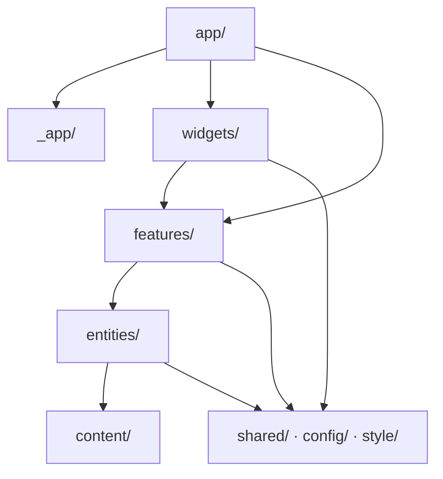

# 구조와 의존 방향

단일 Next.js 앱이다. 앱 안은 CleanFSD 로 나눈다.
슬라이스 분할은 FSD(Feature-Sliced Design)를 따르고, entity 안의 데이터 접근은 계층으로 나눈다.
Kozipsa(`admin-next/docs/architecture.md`)의 구조를 가져오고, 백엔드가 없어 필요 없는 부분은 뺐다.(2026-11-11 사용자 결정)

**파일을 새로 만들거나 옮기기 전에 이 문서를 읽는다.**
이름을 짓는 규칙은 [conventions.md](./conventions.md) 에 있다.

## 원칙

1. **의존은 위에서 아래로만 흐른다.** 역방향 import 를 하지 않는다.
   - `entities` 가 `features` 를 참조하면 도메인 로직이 특정 화면에 묶여 재사용할 수 없다.(Kozipsa 원칙 2)
2. **애매하면 좁은 범위에 둔다.** 2번째 사용처가 생겼을 때 위로 올린다.(Kozipsa 원칙 3)
3. **최상위 디렉터리를 새로 만들지 않는다.** `src` 아래 10개가 전부다.(Kozipsa 원칙 4)

## 1. Kozipsa 와 다른 점

| 항목          | Kozipsa                                   | 이 저장소                            | 이유                                       |
| ------------- | ----------------------------------------- | ------------------------------------ | ------------------------------------------ |
| 저장소        | pnpm + Turborepo 모노레포                 | 단일 앱                              | 앱이 하나라 공용 패키지로 나눌 대상이 없다 |
| 데이터        | 백엔드 API                                | `content/` 의 로컬 파일              | 서버 데이터가 없다                         |
| entity        | model · actions · services · repositories | model · services · repositories      | 서버 액션으로 부를 변경 요청이 없다        |
| 디자인 시스템 | `packages/ui` + Storybook                 | `src/shared/ui` + `src/style/tokens` | UI 를 함께 쓸 다른 앱이 없다               |
| 상태          | Zustand · TanStack Query                  | 쓰지 않는다                          | 전역 상태와 서버 상태가 없다               |

모두 2026-11-11 플랜 승인 때 정했다.

## 2. 디렉터리

```
portfolio/
├── content/          작업 원문 (projects.ts)
├── docs/             규칙 문서
├── e2e/              Playwright
└── src/
    ├── _app/         Provider·전역 리스너
    ├── app/          App Router 라우트
    ├── widgets/      여러 기능을 조합한 UI (header, footer, backdrop)
    ├── features/     기능 단위 (hero, featuredProjects, …)
    ├── entities/     도메인 데이터 (project)
    ├── shared/       앱 공용 (ui/, util/)
    ├── config/       사이트 정보, 내비게이션
    ├── style/        global.css, tokens/
    ├── asset/        SVG 등 정적 자원
    └── types/        .d.ts 앰비언트 선언
```

## 3. 계층

```
app/          라우트. page/layout/error, opengraph-image, sitemap 만. 로직 금지
_app/         Provider. app/ 만 import 한다
widgets/      여러 feature 를 조합하는 UI
features/     기능 단위. ui/ + model/ + index.ts
entities/     도메인 데이터. model/ · services/ · repositories/
shared/       도메인 무관 공용. ui/ · util/
config · style · asset · types   어느 계층에서나 import 할 수 있다
```

의존은 `app → widgets → features → entities → shared` 한 방향이다.



**`entities` 끼리도 서로 import 하지 않는다.** 조합이 필요하면 상위인 `features` 에서 합친다.(Kozipsa 3절)

**`features` 끼리, `widgets` 끼리도 서로 import 하지 않는다.** 슬라이스 사이의 조합은 한 단계 위에서 한다.

**슬라이스는 `index.ts` 로만 공개한다.** 바깥에서 `@/features/hero/ui/Hero` 처럼 안쪽 파일을 부르지 않는다.(Kozipsa conventions 4.1)

이 절의 규칙은 ESLint 가 검사한다.(`eslint.config.mjs` 의 `boundaries/dependencies` 와 `no-restricted-imports`)

### 3.1 계층 판단 기준

| 계층        | 판단 기준                                          |
| ----------- | -------------------------------------------------- |
| `app/`      | "URL 에 대응하는가?"                               |
| `widgets/`  | "여러 feature 를 조합하거나 모든 페이지에 붙는가?" |
| `features/` | "하나의 섹션·기능 단위인가?"                       |
| `entities/` | "프로젝트·경력 같은 데이터인가?"                   |
| `shared/`   | "도메인 무관인가?"                                 |

### 3.2 공통 컴포넌트를 두는 곳

위에서부터 검토해 **가장 먼저 해당하는 곳**에 둔다.(Kozipsa 3.2 에서 후보만 줄였다)

```
shared/ui       ← 도메인 무관 기본 컴포넌트 (Button, Icon, Panel)
widgets/        ← 여러 기능을 조합한 UI
features/*/ui   ← 특정 기능에서만 쓰는 UI
```

## 4. Entity 계층

목적은 **파일을 읽는 위치를 `repositories` 한 곳으로 고정**하는 것이다.
원문 형식이 바뀌어도 `repositories` 만 고치면 된다.

```
page(서버 컴포넌트) → <e>.services.ts → <e>.repositories.ts → content/
```

| 계층           | 책임                                             | 금지            |
| -------------- | ------------------------------------------------ | --------------- |
| `services`     | 가공(정렬, 날짜 포맷, 화면용 `~Data` 로 변환)    | 직접 파일 읽기  |
| `repositories` | `interface` 선언과 구현. 파일 읽기와 스키마 검증 | 가공            |
| `model`        | zod 스키마, 타입                                 | 파일 읽기, 가공 |

**entity 는 서버에서만 실행한다.** `services` 와 `repositories` 첫 줄에 `import 'server-only';` 를 둔다.
클라이언트 컴포넌트에는 `page` 가 가공된 `~Data` 를 prop 으로 넘긴다.

**`repositories` 는 `interface` 를 먼저 선언하고, JSDoc 은 interface 멤버에만 단다.**(Kozipsa 4절)

## 금지사항

| 금지                                       | 대신                                 | 근거                                                             |
| ------------------------------------------ | ------------------------------------ | ---------------------------------------------------------------- |
| `entities` 에서 `features` 를 import       | `features` 에서 조합                 | 도메인 로직이 특정 화면에 묶인다(Kozipsa)                        |
| 슬라이스끼리 서로 import                   | 한 단계 위에서 조합                  | 두 슬라이스를 따로 고칠 수 없게 된다(Kozipsa)                    |
| 슬라이스 내부 파일을 직접 import           | `index.ts` 로 가져온다               | 폴더 안을 옮길 때마다 부르는 쪽을 고쳐야 한다(Kozipsa)           |
| 최상위에 새 디렉터리 생성                  | 10개 안에서 위치를 찾는다            | Kozipsa 원칙 4                                                   |
| 클라이언트 컴포넌트에서 `fs` · entity 호출 | 서버 `page` 가 읽어 prop 으로 넘긴다 | 서버 전용 코드가 번들에 들어간다                                 |
| `repositories` 에서 가공                   | `services` 에서 한다                 | 가공이 흩어지면 원문 형식이 바뀔 때 고칠 곳을 못 찾는다(Kozipsa) |

## 미정리 항목

- feature 는 `hero` · `featuredProjects` · `skills` · `about` · `contact`, widget 은 `header` · `footer` · `backdrop`, entity 는 `project` 하나다.

## 확인방법

```bash
# 계층 의존 방향과 슬라이스 공개 범위. 기대: 출력 없음
pnpm lint

# 최상위 디렉터리. 기대: _app app asset config entities features shared style types widgets
ls -d src/*/ | sed 's|src/||;s|/||' | tr '\n' ' '

# entity 3계층. 기대: 출력 없음
for d in src/entities/*/; do n=$(ls "$d" | grep -cE "^(model|services|repositories)$"); [ "$n" -lt 3 ] && echo "$d ($n/3)"; done
```
