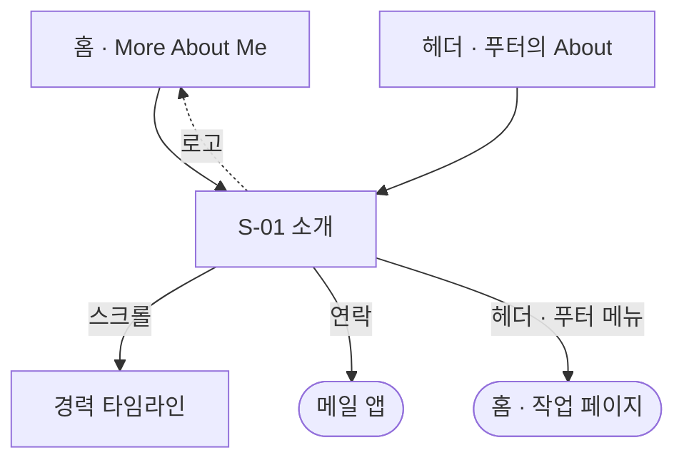
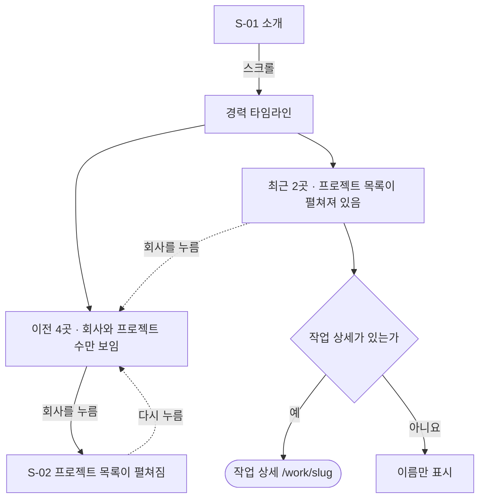

# 소개 — 유저 플로우

[README.md](./README.md) 의 정책을 기준으로 방문자 동작을 흐름으로 옮겼다.

## 1. 전체 흐름

- 연락의 흐름은 홈과 같다.([home/userflow.md](../home/userflow.md) 4절)
- 헤더의 About 이 이 페이지다. 홈의 More About Me 로도 들어온다.

## 2. 경력 보기

- 처음부터 펼치는 기준은 시작한 해가 2014년 이후인가다. KOCOM 과 NEWEN AI 가 해당한다.
- 작업 상세가 있는지는 프로젝트마다 본다. 접힌 회사의 프로젝트도 같다.
- 정책은 [README.md](./README.md) 「경력」 에 있다.
