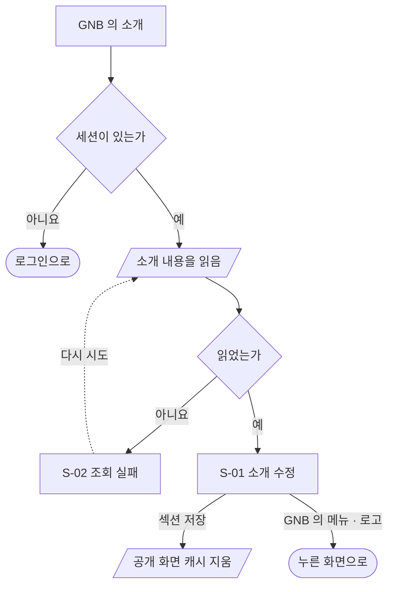
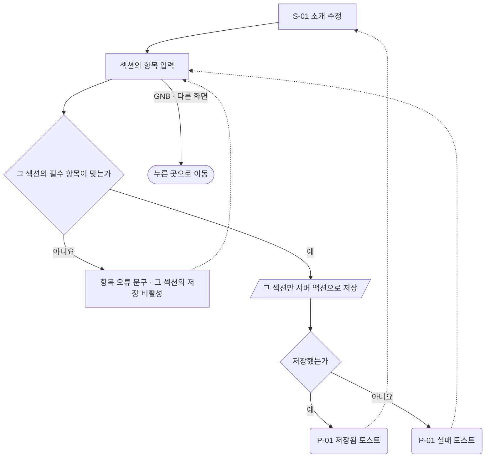

# 소개 관리 — 유저 플로우

[README.md](./README.md) 의 정책을 기준으로 관리자 동작을 흐름으로 옮겼다.
화면 ID(`S-01` 등)는 [wireframe.html](./wireframe.html) 의 ID 와 같다.

## 1. 전체 흐름

- 세션 검사와 로그인은 [로그인의 흐름](../login/userflow.md)과 같다.
- 이 화면에는 등록과 삭제가 없다.
- 저장하지 않은 섹션이 있어도 GNB 를 누르면 묻지 않고 옮긴다. 그 섹션의 내용은 남지 않는다.

## 2. 소개 수정

- 섹션은 인트로 · 일하는 방식 · 기술 묶음 · 홈 소개 4개다. 저장 버튼이 섹션마다 있다.
- 저장해도 화면을 옮기지 않는다. 다른 섹션에 고친 내용이 있으면 그대로 남는다.
- 고친 내용이 없는 섹션의 저장 버튼은 비활성이다.
- 저장에 실패하면 입력한 내용을 그대로 둔다.
- 세션이 끝난 뒤 저장을 누르면 저장하지 않고 로그인으로 보낸다. 입력하던 내용은 남지 않는다.
