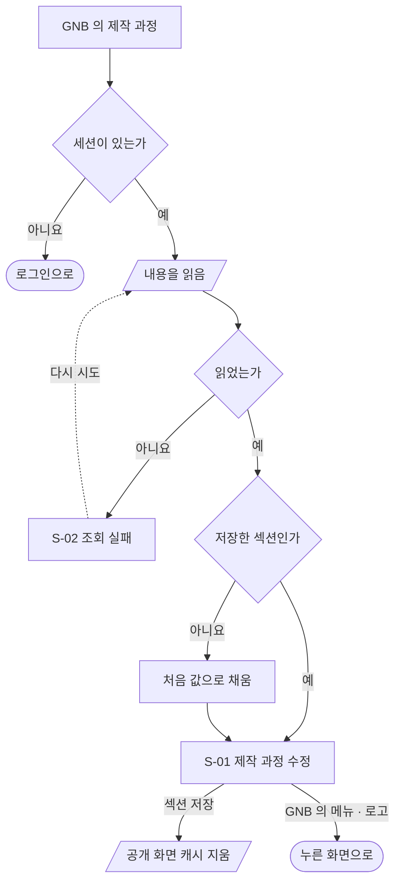
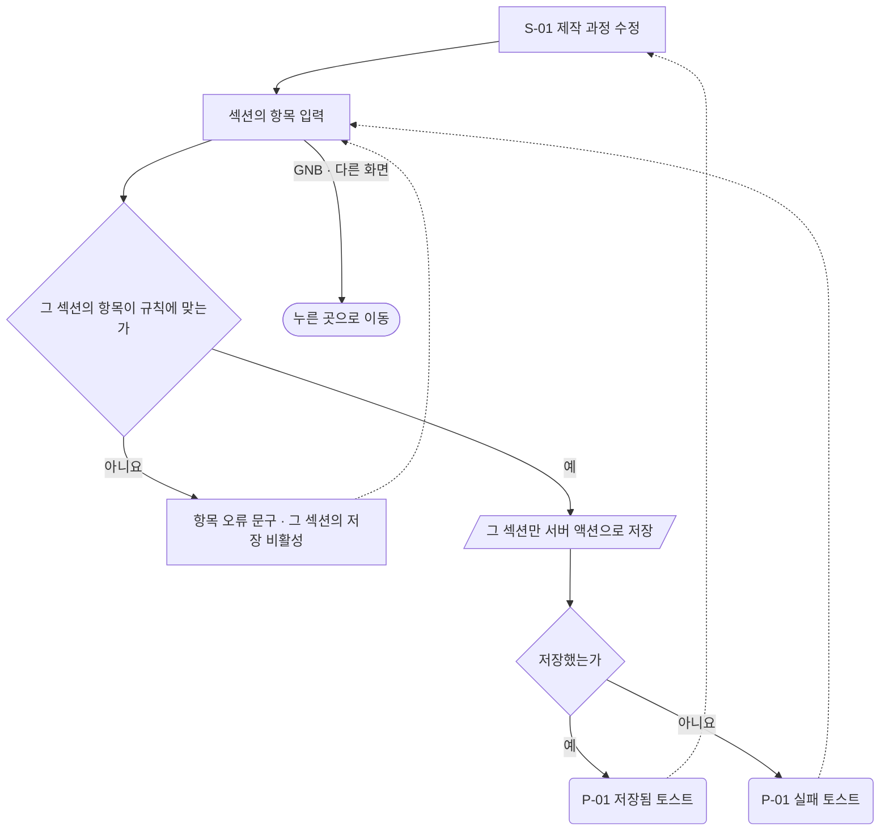

# 제작 과정 관리 — 유저 플로우

[README.md](./README.md) 의 정책을 기준으로 관리자 동작을 흐름으로 옮겼다.
화면 ID(`S-01` 등)는 [wireframe.html](./wireframe.html) 의 ID 와 같다.

## 1. 전체 흐름

- 세션 검사와 로그인은 [로그인의 흐름](../login/userflow.md)과 같다.
- 섹션에는 등록과 삭제가 없다. 섹션 안의 목록은 더하고 뺀다.
- 저장한 섹션인지는 섹션마다 따로 본다. 저장소에 그 섹션의 문서가 없으면 처음 값을 그리고 수정 일시를 적지 않는다.([README.md](./README.md) 「처음 값」)
- 저장하지 않은 섹션이 있어도 GNB 를 누르면 묻지 않고 옮긴다. 그 섹션의 내용은 남지 않는다.

## 2. 내용 수정

- 섹션은 페이지 소개, 전체 과정, 디자인, 개발 과정, 품질을 지키는 방법, 제가 한 일, 기술과 폰트까지 7개다. 각 섹션에서 개별적으로 저장한다.
- 항목 입력에는 목록의 항목을 더하고 빼고 옮기는 것도 들어간다. 섹션마다의 목록은 [README.md](./README.md) 「목록」 표에 있다.
- 항목을 더하면 빈 항목이 생긴다. 필수 항목을 채우기 전에는 그 섹션을 저장할 수 없다.
- 역할 · 이어지는 섹션 · 견본 글꼴은 선택 상자로 고른다. 비울 수 없어 오류 문구가 없다.
- 저장 후에도 현재 화면에 머문다. 다른 섹션에서 편집 중인 내용은 유지한다.
- 변경 사항이 없는 섹션은 저장 버튼을 비활성화한다.
- 저장에 실패하면 입력한 내용을 그대로 둔다.
- 세션이 만료된 뒤 저장을 누르면 로그인 화면으로 이동한다. 입력한 내용은 저장되지 않는다.
