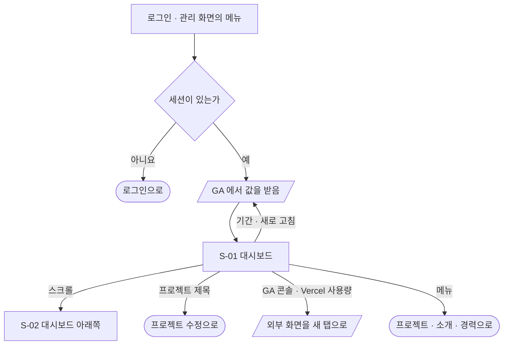
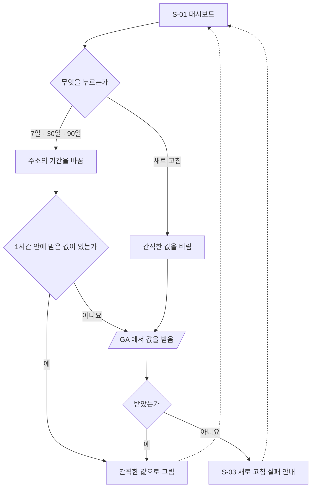
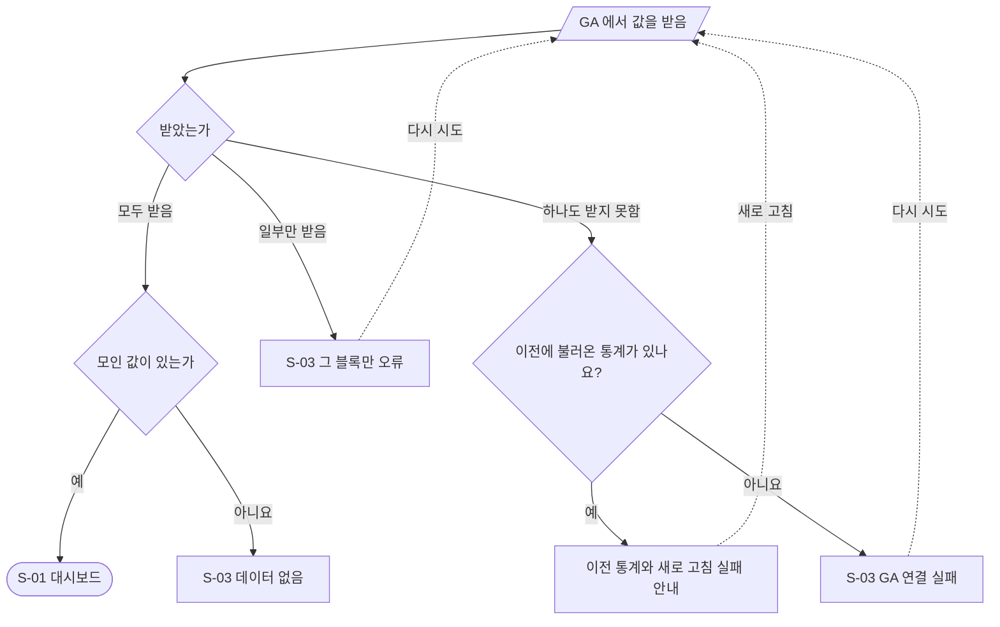

# 대시보드 — 유저 플로우

[README.md](./README.md) 의 정책을 기준으로 관리자 동작을 흐름으로 옮겼다.
화면 ID(`S-01` 등)는 [wireframe.html](./wireframe.html) 의 ID 와 같다.

## 1. 전체 흐름

- 세션 검사와 로그인은 [로그인의 흐름](../login/userflow.md)과 같다. 로그인하면 이 화면으로 온다.
- S-02 는 2차에 더하는 블록이다. 1차에는 S-01 만 있다. 최근 30분 방문자만 먼저 만들어 S-01 의 기간 줄 아래에 있다.(2026-11-24 사용자 결정)
- 이 화면에는 저장하는 동작이 없다.

## 2. 기간 바꾸기 · 새로 고침

- 기간을 바꾸면 최근 30분 방문자 수를 제외한 모든 통계가 함께 갱신된다.
- 값은 기간마다 따로 간직한다. 30일의 값이 있어도 7일은 처음에 새로 받는다.
- 새로 고침은 지금 고른 기간의 값만 버린다.
- 통계를 불러오는 동안 각 블록에 로딩 상태를 표시하고 새로 고침 버튼을 비활성화한다.

## 3. 통계를 불러오지 못한 경우

- 통계를 불러오지 못해도 메뉴를 통해 다른 관리 화면을 이용할 수 있다.
- 데이터 없음은 오류가 아니다. 추적 코드를 넣은 직후에 이 상태다.
- 일부 통계만 불러오지 못하면 해당 블록에만 오류 메시지를 표시한다.
