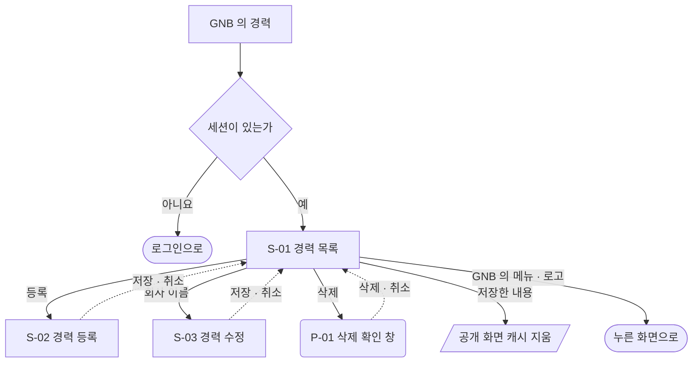
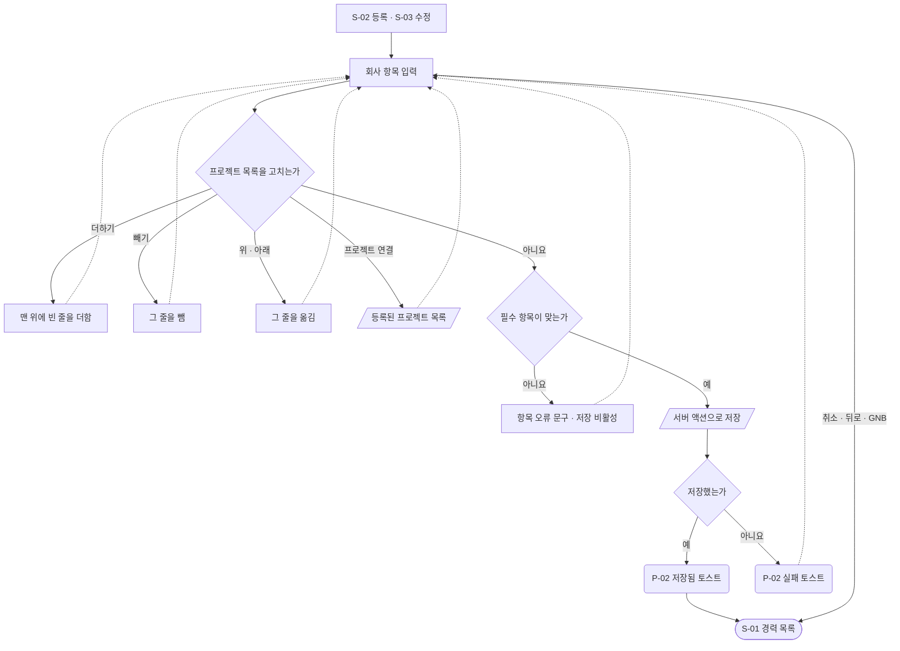
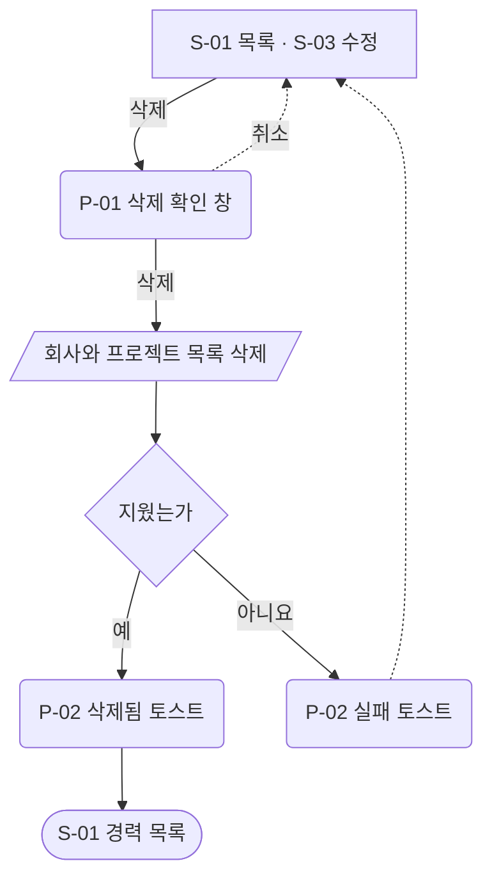

# 경력 관리 — 유저 플로우

[README.md](./README.md) 의 정책을 기준으로 관리자 동작을 흐름으로 옮겼다.
화면 ID(`S-01` 등)는 [wireframe.html](./wireframe.html) 의 ID 와 같다.

## 1. 전체 흐름

- 세션 검사와 로그인은 [로그인의 흐름](../login/userflow.md)과 같다.
- 등록 · 수정 화면에서 저장하지 않은 내용이 있어도 GNB 를 누르면 묻지 않고 옮긴다.
- 등록된 경력이 없거나 목록을 불러오지 못하면 S-04에서 해당 상태를 표시한다.

## 2. 경력 등록 · 수정

- `id` 는 등록할 때 저장소가 발급한다. 입력받지 않는다.
- 프로젝트 목록을 고친 것은 저장을 눌러야 반영한다. 줄을 빼는 데는 확인 창을 띄우지 않는다.
- 프로젝트 연결에는 공개 · 비공개 프로젝트를 모두 보여 준다. 고르지 않아도 저장할 수 있다.
- 재직 중을 켜면 떠난 해 입력이 없어진다.
- 취소하거나 다른 화면으로 이동하면 확인창 없이 편집을 종료한다. 저장하지 않은 변경 사항은 사라진다. 취소 버튼을 누르면 경력 목록으로 돌아간다.
- 세션이 만료된 뒤 저장을 누르면 로그인 화면으로 이동한다. 입력한 내용은 저장되지 않는다.

## 3. 경력 삭제

- 삭제는 되돌릴 수 없다.
- 경력을 삭제해도 연결한 프로젝트는 유지한다.
