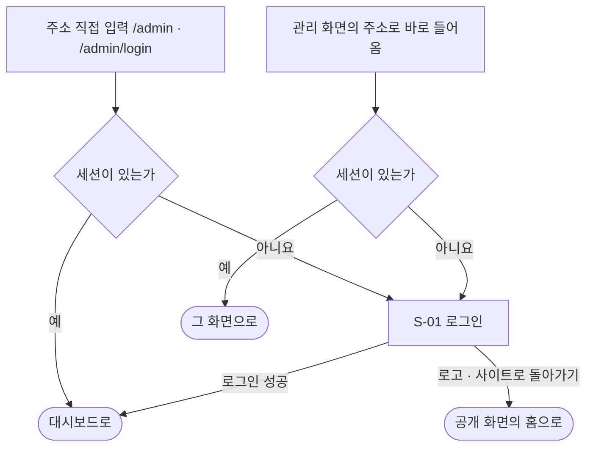
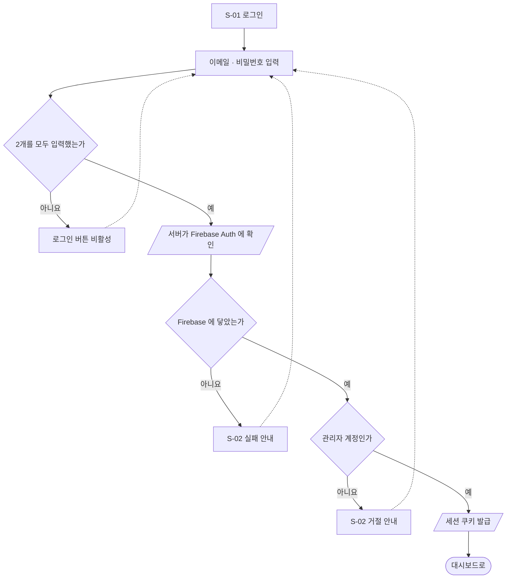
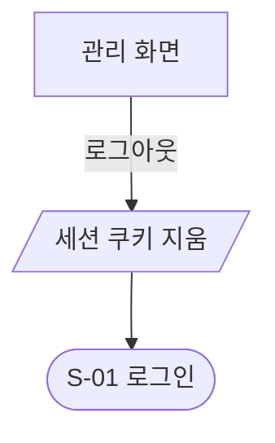
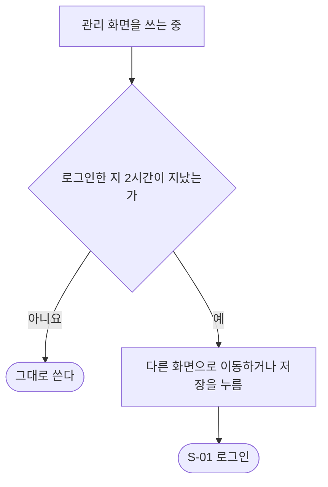

# 로그인 — 유저 플로우

[README.md](./README.md) 의 정책을 기준으로 관리자 동작을 흐름으로 옮겼다.
화면 ID(`S-01` 등)는 [wireframe.html](./wireframe.html) 의 ID 와 같다.

## 1. 전체 흐름

- 세션은 `/admin` 아래의 모든 화면에서 서버가 검사한다.
- `/admin` 은 화면을 그리지 않는다. 세션에 따라 로그인이나 대시보드로 보낸다.
- 로그인하지 않고 관리 화면의 주소로 들어와도, 로그인한 뒤에는 대시보드로 간다. 들어오려던 주소는 기억하지 않는다.
- 대시보드부터의 흐름은 [대시보드](../dashboard/userflow.md)에 있다.

## 2. 로그인

- 관리자 계정은 Firebase 콘솔에서 Firebase Auth 에 등록한 계정이다. 로그인 화면에서는 가입할 수 없다.
- 「관리자 계정인가」 는 2가지를 본다. 이메일과 비밀번호가 맞고, 그 계정의 UID 가 `ADMIN_UID` 와 같아야 한다.
- 거절과 실패 모두 세션을 만들지 않는다. 입력한 값은 그대로 둔다.
- 확인하는 동안 로그인 버튼은 비활성이다.

## 3. 로그아웃

- 로그아웃 버튼은 각 관리 화면의 헤더에 있다.([대시보드 와이어프레임](../dashboard/wireframe.html#s01))
- 확인 창을 거치지 않는다.

## 4. 세션 만료

- 세션은 쓰는 동안에도 늘어나지 않는다.
- 저장 버튼을 누른 경우에는 입력한 내용을 저장하지 않고 로그인 화면으로 이동한다.
- 시간이 다 됐다고 미리 알리지 않는다.
