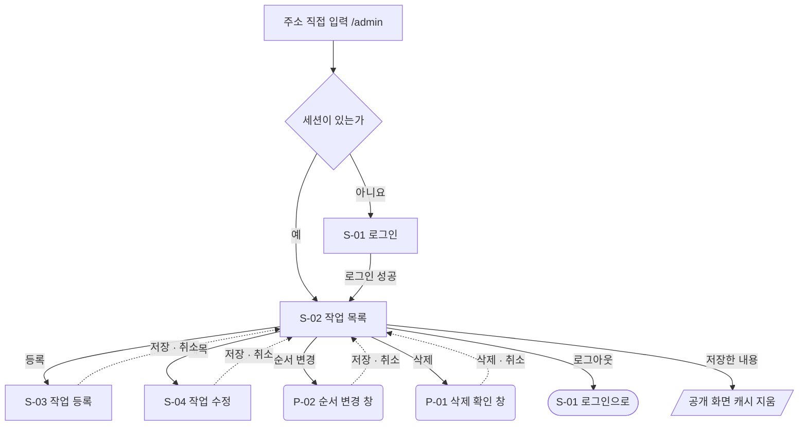
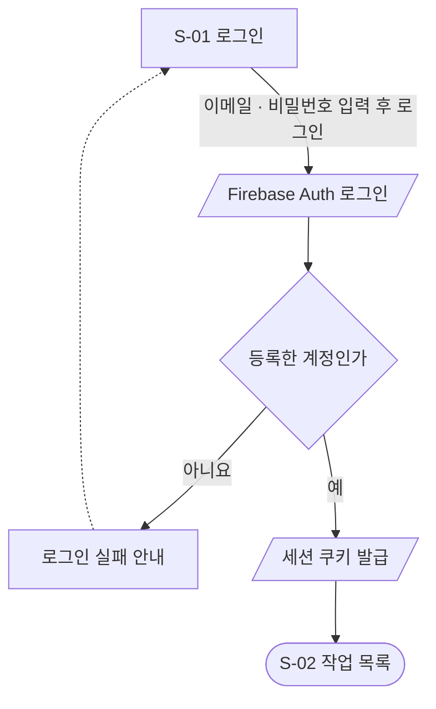
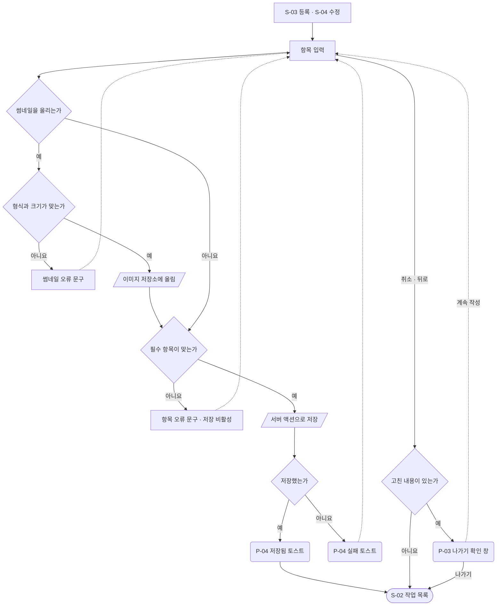
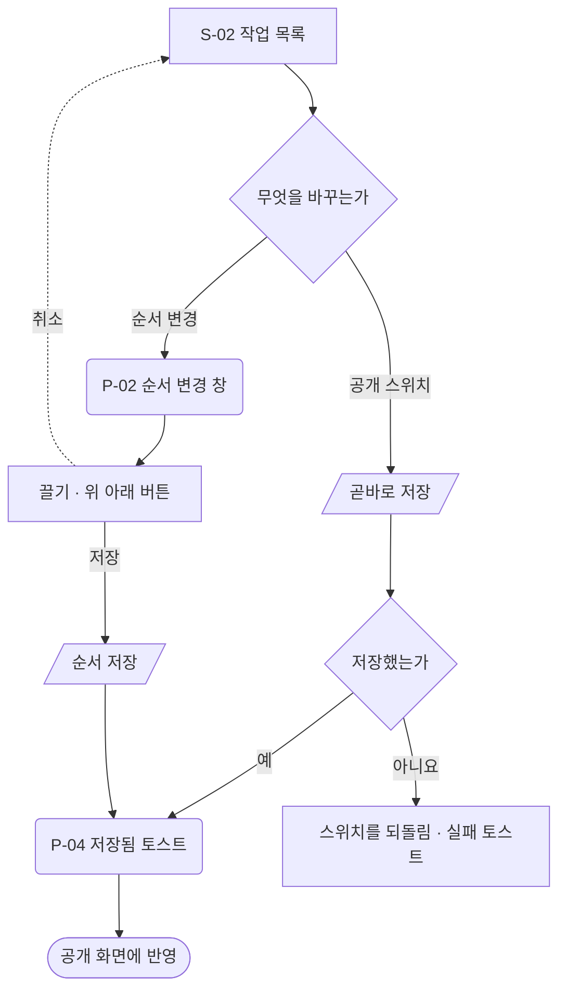
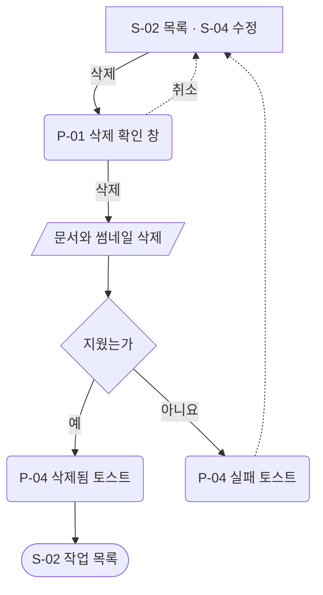

# 작업 관리 — 유저 플로우

[README.md](./README.md) 의 정책을 기준으로 관리자 동작을 흐름으로 옮겼다.
화면 ID(`S-01` 등)는 [wireframe.html](./wireframe.html) 의 ID 와 같다. `제안` 동작이 섞여 있다.

## 1. 전체 흐름

- 세션은 `/admin` 아래의 모든 화면에서 서버가 검사한다. 수정 화면의 주소로 바로 들어와도 같다.
- 공개 화면은 저장한 직후의 내용을 그린다. 흐름은 [홈](../home/userflow.md)에 있다.

## 2. 로그인

- 관리자 계정은 Firebase 콘솔에서 Firebase Auth 에 등록한 계정이다. 관리 화면에서는 가입할 수 없다.
- 로그인 수단은 이메일과 비밀번호다(제안).
- 로그인에 실패하면 세션을 만들지 않는다. 안내 문구는 [S-01](./wireframe.html#s01)에 있다.
- 세션이 끝난 뒤 저장을 누르면 저장하지 않고 S-01 로 보낸다. 쓰던 내용은 남지 않는다.

## 3. 작업 등록 · 수정

- `id` 는 등록할 때 저장소가 발급한다. 입력받지 않는다.
- 썸네일은 저장을 누르기 전에 올린다. 저장하지 않고 나가면 올린 파일을 지운다.
- 저장에 실패하면 입력한 내용을 그대로 둔다.

## 4. 순서 · 공개 바꾸기

- 순서를 하나도 바꾸지 않았으면 순서 변경 창의 저장 버튼은 비활성이다.

## 5. 작업 삭제

- 삭제는 되돌릴 수 없다. 공개 화면에서 내리기만 하려면 공개 스위치를 끈다.
