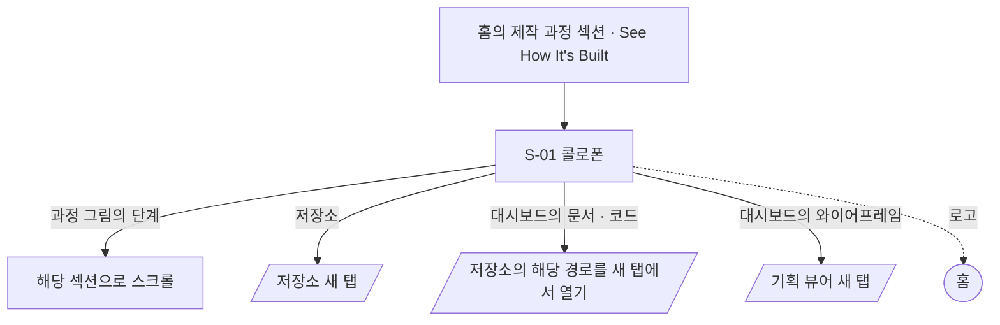

# 제작 과정 — 유저 플로우

[README.md](./README.md) 의 정책을 기준으로 방문자가 제작 과정 페이지를 탐색하는 순서를 정리했다. 홈의 제작 과정 섹션에서 이 페이지를 열 수 있다.([홈 기획](../home/README.md) 「제작 과정 섹션」)

## 1. 전체 흐름

- 과정 그림의 단계마다 이어지는 섹션은 [README.md](./README.md) 「과정 한눈에」 표에 있다.
- 대시보드의 관리 화면으로는 가지 않는다. 링크를 걸지 않는다.
