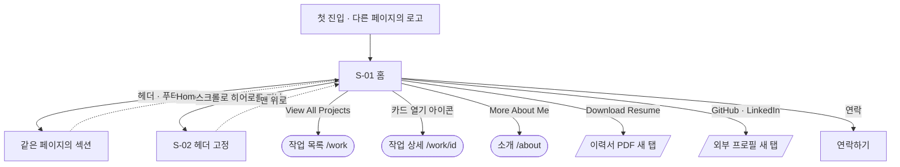
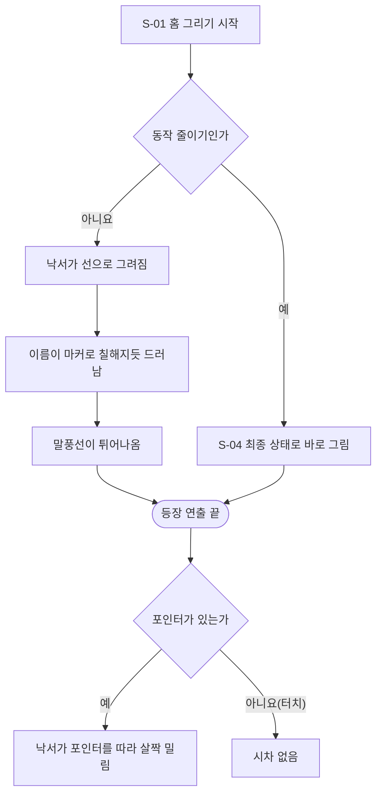
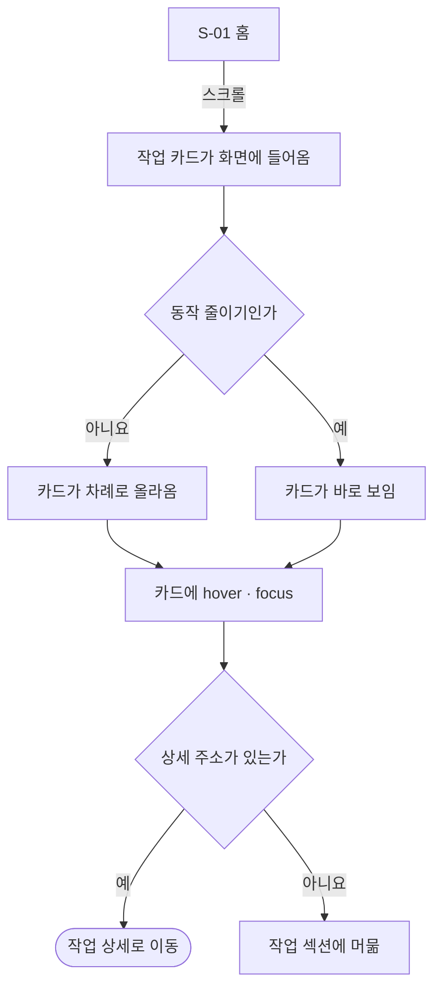
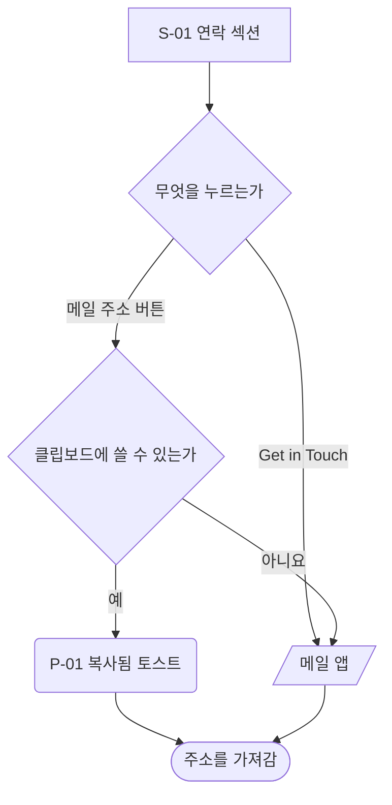

# 홈 — 유저 플로우

[README.md](./README.md) 의 정책을 기준으로 방문자 동작을 흐름으로 옮겼다.
화면 ID(`S-01` 등)는 [wireframe.html](./wireframe.html) 의 ID 와 같다. `제안` 동작이 섞여 있다.

## 1. 전체 흐름

- 작업 목록 · 상세 · 소개는 다른 기획 문서에 있다. [work/](../work/README.md) · [about/](../about/README.md)
- 같은 페이지 안의 이동은 `scroll-behavior: smooth` 로 부드럽게 이동한다. 동작 줄이기면 바로 이동한다.(`src/style/global.css`)

## 2. 처음 들어옴

- 등장 연출은 한 번만 실행한다. 다른 페이지에 갔다가 돌아와도 다시 실행하지 않는다(제안). 첫 방문을 위한 연출이라, 매번 나오면 방문자가 기다려야 하기 때문이다.
- 포인터 시차도 동작 줄이기에서는 하지 않는다.

## 3. 작업 보기

- 상세 주소가 없는 작업은 `href` 가 `#projects` 다.(`src/entities/project/services/project.services.ts`) 작업 상세가 생기면 모든 카드에 주소가 생긴다(제안).

## 4. 연락하기

- 메일 주소 버튼의 복사는 `제안` 이다. 지금은 버튼 2개 모두 `mailto:` 다.(`src/features/contact/ui/Contact.tsx`)
