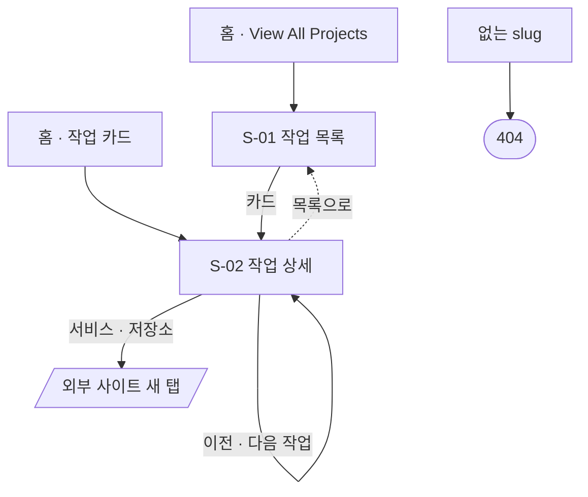
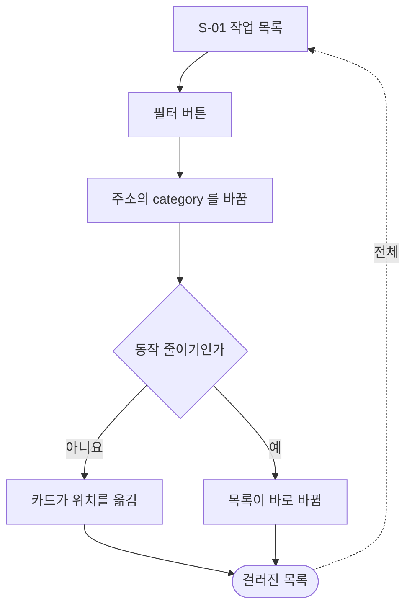

# 작업 목록 · 상세 — 유저 플로우

[README.md](./README.md) 의 정책을 기준으로 방문자 동작을 흐름으로 옮겼다. 초안이라 모든 흐름이 `제안` 이다.
화면 ID 는 [wireframe.html](./wireframe.html) 의 ID 와 같다.

## 1. 전체 흐름

- 목록으로 돌아가면 고른 필터가 남아 있다. 주소에 남겼기 때문이다.

## 2. 분류로 거르기

